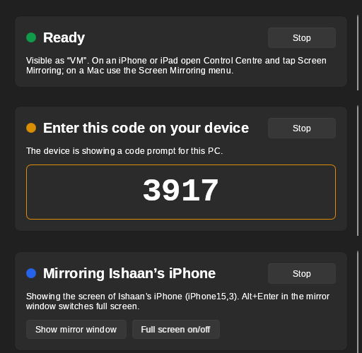

# MirrorDeck

A Windows 10/11 desktop app that turns the PC into an AirPlay receiver. The PC appears in the Screen
Mirroring / AirPlay list of iPhones, iPads and Macs on the same network; the device's screen and sound
then play on the PC.



> **Project status, in one paragraph.** The receiver core is covered by 130 automated tests, including
> runs against the real, unmodified AirPlay engine in which the receiver is found by a genuine mDNS
> browse under its configured name. The Windows app has been compiled, published and driven through all
> of its states under Wine. It has **not** yet been run on a real Windows PC or connected to a real
> Apple device, because neither was available where it was written. The engine has to be built once on
> Windows (one script, below). Details: [What has been verified](#what-has-been-verified).

MirrorDeck is an independent project. It is not affiliated with, endorsed or certified by Apple Inc.
AirPlay, iPhone, iPad and Mac are trademarks of Apple Inc.

## Stack and architecture

| Layer | Choice | Licence |
|---|---|---|
| AirPlay protocol, FairPlay handshake, decryption, discovery | [UxPlay](https://github.com/FDH2/UxPlay) 1.74, unmodified, as a child process | GPL-3.0 |
| Decoding and rendering | GStreamer (Direct3D 11/12 sinks and hardware decoders, FFmpeg as fallback) | LGPL-2.1+ / see [licences](#licences) |
| Control panel | C# / WPF on .NET 10 | MIT (runtime) |
| Packaging | self-contained folder, or MSIX with firewall rules in the manifest | n/a |

Why this stack: UxPlay is the actively maintained descendant of RPiPlay and follows current iOS and
macOS releases, so the protocol is not re-implemented here. Since version 1.74 it brings its own mDNS
responder, which removes the dependency on Apple's Bonjour service (something an MSIX package cannot
install). Running it as a separate process keeps the Windows-specific code (UI, firewall, packaging) small and
testable, and means the engine can be updated by changing one commit hash.

```
 iPhone / iPad / Mac                         Windows PC
 ───────────────────                         ──────────────────────────────────────────────────
                                             MirrorDeck.exe (WPF)
   AirPlay menu  ◄── mDNS (UDP 5353) ──┐       │  writes engine.rc, starts and supervises
                                       │       │  reads the log  ──►  status, code prompt, errors
   screen + audio ── TCP 7000/7100 ──┐ │       ▼
                     UDP 6000/6001/  │ └──►  engine\bin\uxplay.exe  (UxPlay + GStreamer)
                         7011        └────►    │  handshake, decryption, H.264/H.265 + AAC/ALAC decode
                                               ▼
                                             mirror window (Direct3D)   +   sound (WASAPI)
```

UxPlay has no control API; its console output is the interface. `EngineLogParser` turns that output
into state, and every pattern in it is annotated with the UxPlay source file it comes from.

## What works, and what does not

| | |
|---|---|
| Discovery: the PC appears in the AirPlay list | Yes. Built-in mDNS responder; Bonjour is not needed. The responder is new in UxPlay 1.74, which upstream still labels experimental; a Bonjour-based build is the fallback (see [Network and firewall](#network-and-firewall)) |
| Screen mirroring with sound (iPhone, iPad, Mac) | Yes. H.264 up to 1080p at 30 or 60 fps; hardware decoding where the GPU offers it |
| 4K HEVC mirroring | Optional (Advanced). Needs a recent Apple device and an HEVC-capable GPU |
| Audio-only AirPlay (Music, podcasts), lossless | Yes |
| Photos | Through screen mirroring. The separate AirPlay photo protocol is not implemented by the engine |
| Video casting (the AirPlay button inside video apps) | YouTube app only, experimental, off by default. Other apps send sound only |
| **Copy-protected video** (Netflix, Apple TV+, Disney+, Prime Video, purchased films) | **No, and it cannot be added.** See below |
| Multi-room audio, HomeKit, remote control, AirPlay from Windows to other devices | No |
| Editable receiver name; resizable or full-screen mirror window | Yes |
| Access control | Open, pairing code on first connection, new code on every connection, or password |

**Protected content.** Apple devices only release DRM-protected video (FairPlay Streaming) to receivers
that hold keys Apple issues to licensed hardware. No independent receiver has them; as far as is
publicly known, that includes the commercial ones in the Microsoft Store. While mirroring, such apps
show a black picture and only the sound comes through. The closest alternative is to play that content
in the service's own Windows app or in a browser on the PC.

**Protocol longevity.** UxPlay speaks AirPlay 2 in what Apple calls legacy mode. It works with current
iOS and macOS, but Apple could remove that mode in a future release, and neither this project nor
UxPlay can prevent it.

## Quick start

You need Windows 10 (1809 or later) or Windows 11, the [.NET 10 SDK](https://dotnet.microsoft.com/download)
and [MSYS2](https://www.msys2.org) in its default location (`C:\msys64`).

```powershell
git clone https://github.com/ishaanbhatia113-collab/Airplay-Iphone
cd Airplay-Iphone

# 1. Build the AirPlay engine once (it takes a while, mostly downloads). Result: engine\dist
pwsh scripts/build-engine.ps1

# 2. Run the app
dotnet run --project src/MirrorDeck
```

`build-engine.ps1` runs `engine/build-engine.sh` inside MSYS2. That script installs the compiler and
GStreamer through MSYS2's package manager, builds UxPlay at a pinned commit, copies it with every DLL
it needs into `engine\dist`, and finally starts the result with nothing but the bundle on `PATH` to
prove that it is complete. On Windows on ARM add `-Environment CLANGARM64`.

The scripts are written for PowerShell 7 (`pwsh`) and also run in Windows PowerShell 5.1
(`powershell -ExecutionPolicy Bypass -File scripts\build-engine.ps1`).

`pwsh scripts/smoke-test-engine.ps1` starts the bundled engine on its own for a few seconds and tells
you whether it came up; use it if the app reports that the engine does not start.

**Without installing MSYS2:** the repository has a GitHub Actions workflow (`.github/workflows/build.yml`)
that builds the engine and the app on a Windows runner and attaches the result as a downloadable
artifact. It is started by hand (Actions > build > Run workflow) and never runs on its own, because
Windows runners are billed at twice the normal rate against a private repository's Actions minutes.
It has not been run yet.

The app starts the receiver as soon as it opens. On the very first start Windows asks whether
`uxplay.exe` may accept connections: choose **Allow** for private networks. (Or use the *Allow through
Windows Firewall* button in the app; see [Network and firewall](#network-and-firewall).)

### Check that the PC shows up

1. PC and Apple device on the **same** Wi-Fi or wired network. The status card says **Ready**.
2. iPhone or iPad: open Control Centre (swipe down from the top-right corner; on models with a Home
   button, swipe up from the bottom edge) and tap **Screen Mirroring**. The PC's name appears within a few seconds. Tap it: the mirror window opens on the PC
   and the status card changes to **Mirroring …**.
3. Mac: Control Centre in the menu bar, then **Screen Mirroring**.
4. Sound only: in Music or Control Centre tap the AirPlay icon and choose the PC.

To look at the advertisement independently of an Apple device, browse for it from another computer:
`dns-sd -B _airplay._tcp` on a Mac, `avahi-browse -rt _airplay._tcp` on Linux. On the PC itself,
`Get-NetTCPConnection -LocalPort 7000 -State Listen` shows whether the engine is listening.

If the PC does not show up, the **Set-up check** list in the app names the reason in nearly every
case; [Troubleshooting](#troubleshooting) has the rest.

## Using it

- **Name.** Type a new name and press *Apply changes*; the receiver restarts under the new name, and
  the old one is withdrawn from the network so that devices drop it from their lists. Names can be up
  to 50 bytes long and cannot contain `"`, `\` or a dot (limits of the engine's configuration file
  and of DNS service names).
- **Who can connect.**
  - *Anyone on this network*: no prompt.
  - *Code on first connection*: Apple-style pairing. The app shows a 4-digit code that a new device
    has to enter once; paired devices are remembered (*Forget paired devices* clears the list).
  - *New code for every connection*: a fresh code each time. Suited to meeting rooms.
  - *Password*: fixed, at least 6 characters, stored encrypted with Windows DPAPI for your account.
- **Mirror window.** It opens when a device connects and closes when it leaves. It is an ordinary
  window: resize it, move it to another monitor, press **Alt+Enter** for full screen (or use the
  *Full screen on/off* button). *Open the mirror window in full screen* makes that the default.
- **Closing the app** stops the receiver. Minimise it to keep receiving.
- Settings, the receiver's identity key, the pairing list and `engine.log` live in
  `%LOCALAPPDATA%\MirrorDeck` (*Engine log > Open data folder*).

## Network and firewall

The engine is always started with fixed ports, so that firewall rules can be exact:

| Port | Protocol | Purpose |
|---|---|---|
| 7000 | TCP | control channel (RTSP/HTTP) |
| 7100 | TCP | encrypted mirror video |
| 7001 | TCP | reserved by the engine |
| 6000, 6001 | UDP | audio data and control |
| 7011 | UDP | clock synchronisation |
| 5353 | UDP | mDNS discovery (multicast 224.0.0.251) |

Inbound access is needed on **Private** (or Domain) networks only; nothing is opened on Public ones.

- **Unpackaged app.** Windows shows its "allow this app" prompt at first start. If that prompt was
  ever cancelled, Windows stored a *blocking* rule, which overrides every allow rule and is the classic
  reason for "it never shows up". The Set-up check detects this, and *Allow through Windows Firewall*
  replaces the engine's inbound rules with one allow rule for Private and Domain networks (one UAC
  prompt). `scripts/firewall-rule.ps1` does the same for unattended set-up.
- **MSIX package.** The rules are declared in the manifest (`packaging/AppxManifest.xml`) and are
  installed and removed with the app, without any prompt.
- **Bonjour.** Not required. UxPlay 1.74 answers mDNS queries itself and opens the mDNS port in
  shared mode, as Bonjour and browsers do, so it does not need the port to itself. If its responder
  misbehaves on some network, the engine can be built against Apple's Bonjour instead
  (`engine/build-engine.sh --with-bonjour`); every PC then needs the Bonjour Service, which an MSIX
  package cannot install.
- **Network profile.** On a network marked *Public*, Windows hides the PC and the rules do not apply.
  The Set-up check warns about it and links to the setting.

## Troubleshooting

| Symptom | Cause and fix |
|---|---|
| PC not in the AirPlay list | Open *Set-up check*. In order of likelihood: firewall rule missing or blocking; network set to Public; device on another network (guest Wi-Fi, mobile data, VPN); access point with "client isolation"; third-party security suite filtering `uxplay.exe` |
| "The AirPlay ports are in use" | Another receiver is running (AirServer, LonelyScreen, 5KPlayer, a second UxPlay). Only one can use the ports |
| "AirPlay engine not found" | Run `scripts/build-engine.ps1`, or set the path of an existing `uxplay.exe` under *Advanced* |
| "The receiver did not start" / "stopped unexpectedly" | Run `scripts/smoke-test-engine.ps1`: it shows the engine's own error (a missing DLL or plugin, security software) |
| Connects, but the picture is black | Protected content (see above); or 4K HEVC is enabled without a capable GPU; or try the other renderer under *Advanced* |
| Stutter | Use 5 GHz Wi-Fi or Ethernet; lower *Smoothness* to 30 fps |
| First start is slow | GStreamer indexes its plugins once, and antivirus scans each DLL while it does |
| Old name still listed on a device | Only happens if the engine was killed instead of stopped; the entry expires on its own |

Everything the engine prints is in the *Engine log* section and in `%LOCALAPPDATA%\MirrorDeck\engine.log`.
For UxPlay options without a switch in the UI, use *Advanced > Extra engine options* (one per line, no
leading dash; `d` enables UxPlay's debug output).

## Packaging

```powershell
pwsh scripts/publish.ps1                 # self-contained build in publish\ (no .NET needed on the target PC)
pwsh packaging/make-msix.ps1 -SelfSign   # MSIX signed with a test certificate, for your own PCs
```

`publish\` can be zipped and copied as it is. `make-msix.ps1` needs the Windows SDK (`makeappx`,
`signtool`).

For the Microsoft Store, reserve the name in Partner Center and pass its identity values:

```powershell
pwsh packaging/make-msix.ps1 -IdentityName '<Package/Identity/Name>' `
    -Publisher '<Package/Identity/Publisher>' -PublisherDisplayName '<publisher name>' -Version 1.0.0.0
```

Things the submission needs that code cannot provide:

- The package uses the `runFullTrust` capability (it is a classic desktop app with a native child
  process); Partner Center asks for a one-line justification.
- **Naming.** Describe it as "compatible with AirPlay" in the description; do not use Apple's
  trademarks or the AirPlay glyph in the product name or icon. The bundled icon is original artwork.
- **Licence.** Publish it with the GPL as its licence terms and link to the source (see below).
- Only the tiles referenced by the manifest are included. Scaled and unplated icon variants (crisper
  taskbar icons) would need a `resources.pri` and are not generated.

## Legal position

This section describes the reasoning behind the design. It is not legal advice; take advice before
distributing commercially.

**What AirPlay mirroring requires.** Before an Apple device sends its screen, the receiver has to
complete a handshake ("FairPlay SAP") from which the key for the video stream is derived. Apple
licenses its implementation to hardware makers through the MFi programme; as far as is publicly known
there is no licence that an independent Windows application can obtain. Every third-party software
receiver therefore relies on an independent implementation of that handshake.

**What this project does.**

1. It contains no Apple code and no extracted keys, and it does not implement the handshake itself.
   It runs UxPlay, whose `lib/playfair` component (GPL-3.0) reproduces the handshake. UxPlay's own README calls the legal status of that component unclear, and that
   assessment applies here unchanged. Interoperability exceptions exist (17 U.S.C. §1201(f), Article 6
   of the EU Software Directive), but their application to this case has not been tested in court.
2. It does not touch content protection. FairPlay *Streaming*, the DRM on films and series, is neither
   decrypted nor circumvented; protected video simply does not play.
3. The engine is used unmodified, as a separate program, at a pinned commit, with licence texts and a
   bill of materials generated by the build (`engine\dist\licenses`). That makes the GPL obligations
   straightforward to meet.
4. Apple's trademarks are used only to state compatibility, with a disclaimer in the app and here.

**What follows for distribution.**

- The combination is distributed under the **GPL-3.0**. Selling it is allowed; the recipients must get
  the licence and access to the complete source (this repository plus `ENGINE-SOURCE.txt` and
  `licenses\PACKAGES.txt` from the engine bundle). A closed-source product cannot include UxPlay.
- The Microsoft Store accepts GPL software and paid open-source apps under its current policies;
  check them at submission time.
- The engine bundle contains FFmpeg, whose H.264/HEVC/AAC decoders are covered by patents in some
  countries. Free software distribution normally proceeds without a licence; a commercial product may
  need one. Hardware decoding through Direct3D is used whenever the GPU provides it.

## Licences

MirrorDeck's own code is licensed under the GNU General Public License, version 3 or later
([LICENSE](LICENSE)). Third-party components and their licences are listed in
[THIRD-PARTY-NOTICES.md](THIRD-PARTY-NOTICES.md); the exact package versions of an engine build are
written to `engine\dist\licenses\PACKAGES.txt`.

## What has been verified

| Area | How | Result |
|---|---|---|
| Settings, configuration file, log parser, engine supervision | 130 xUnit tests on Linux | pass |
| Generated configuration against the real engine | UxPlay 1.74 (unmodified, pinned commit) built on Linux and started by `EngineHost` | accepted in every access mode and with every switch |
| Discovery | the tests send real mDNS queries, as an iPhone does | `_airplay._tcp` and `_raop._tcp` answered under the configured (UTF-8) name; records withdrawn on stop |
| Failure handling | port already taken, engine crash, engine missing, start timeout | detected, reported, restarted or stopped as designed |
| Elevated firewall command | executed by real PowerShell against a stand-in `netsh` | arguments arrive intact for paths with spaces, quotes, `$` and commas |
| Windows app | published for win-x64 and run under Wine 9 with `tools/FakeEngine` | window loads; live status, code prompt, mirror-window title and Alt+Enter toggle, graceful stop, engine ends with the app |
| `engine/build-engine.sh` | executed against simulated MSYS2 tools | control flow, bundling and licence collection work; **the real MSYS2 build has not been run** |
| `scripts/*.ps1`, `packaging/make-msix.ps1` | parsed by PowerShell 7; `smoke-test-engine.ps1` also executed against the Linux engine | syntax is valid; the Windows-only steps (MSYS2, `makeappx`, `signtool`) **have not been run** |
| `.github/workflows/build.yml` | YAML validated | **not run** |
| A real AirPlay session, Windows Firewall inspection, MSIX packing, Direct3D rendering | need Windows and an Apple device | **not tested** |

Two findings from testing against the real engine are worth knowing: enabling YouTube casting makes
UxPlay abort at start unless a POSIX locale variable is set, which Windows never does (the app now
sets `LANGUAGE`); and UxPlay keeps running without a listener when its port is taken (the app detects
the message and stops it).

### Running the tests

```bash
dotnet test                                           # unit tests + scripted engine

# against a real UxPlay binary (Linux or macOS; needs coreutils' stdbuf, free AirPlay ports, multicast)
MIRRORDECK_TEST_ENGINE=/path/to/uxplay dotnet test

# with PowerShell 7, the firewall command is executed as well
MIRRORDECK_TEST_PWSH=/path/to/pwsh dotnet test
```

To see every state of the UI without an Apple device, build `tools/FakeEngine` and point
*Advanced > Engine location* at its `uxplay.exe`. It prints what the real engine prints during a
session and opens a stand-in mirror window.

## Repository layout

```
src/MirrorDeck.Core/          platform-independent logic (all of it unit-tested)
  AppSettings.cs                settings, validation, JSON
  EngineConfig.cs               settings -> UxPlay startup file            <- new engine options go here
  EngineLogParser.cs            UxPlay log -> receiver state               <- new states go here
  EngineHost.cs                 starts, watches, restarts and stops the engine process
  EngineLocator.cs              finds uxplay.exe; environment for a bundled GStreamer
  EnginePorts.cs, NetworkProbe.cs, ReceiverStatus.cs, FirewallRuleScript.cs
src/MirrorDeck/               the Windows app (WPF)
  MainWindow.xaml(.cs), App.xaml(.cs), app.manifest
  ViewModels/                   MainViewModel (status, form, commands), Mvvm helpers
  Services/                     FirewallService, Diagnostics, MirrorWindow, EngineProcessSupport
                                (job object, graceful stop), SettingsStore (DPAPI), DisplayAwake, Native
engine/build-engine.sh        builds and bundles UxPlay + GStreamer with MSYS2
scripts/                      build-engine.ps1, smoke-test-engine.ps1, publish.ps1, firewall-rule.ps1
.github/workflows/build.yml   manual workflow: tests on Linux, engine + app (+ MSIX) on Windows
packaging/                    AppxManifest.xml (with firewall rules), make-msix.ps1, tiles
tests/MirrorDeck.Core.Tests/  unit tests, scripted-engine tests, real-engine tests, mDNS browser
tools/FakeEngine/             stand-in uxplay.exe for UI work
tools/make-icons.py           regenerates the icon and tiles
```

### Where the rest plugs in

| Feature | Where |
|---|---|
| Another UxPlay option (recording to MP4, cover art, forwarding to OBS, resolution) | one line in `EngineConfig.BuildRcFile`, one property in `AppSettings`, one control in `MainWindow.xaml`. Until then: *Extra engine options* |
| Picture inside the app window instead of a separate window | UxPlay would have to pass a window handle to GStreamer (`GstVideoOverlay`); see the note in `Services/MirrorWindow.cs` |
| Tray icon, start with Windows | `App.xaml.cs` / `MainWindow.xaml.cs` (closing currently stops the receiver by design) |
| List of paired devices with per-device removal | the register is a text file, `%LOCALAPPDATA%\MirrorDeck\engine\paired-devices.txt` |
| A newer engine | change `UXPLAY_COMMIT` in `engine/build-engine.sh`, then re-check the patterns in `EngineLogParser.cs` against the sources named next to each one |
